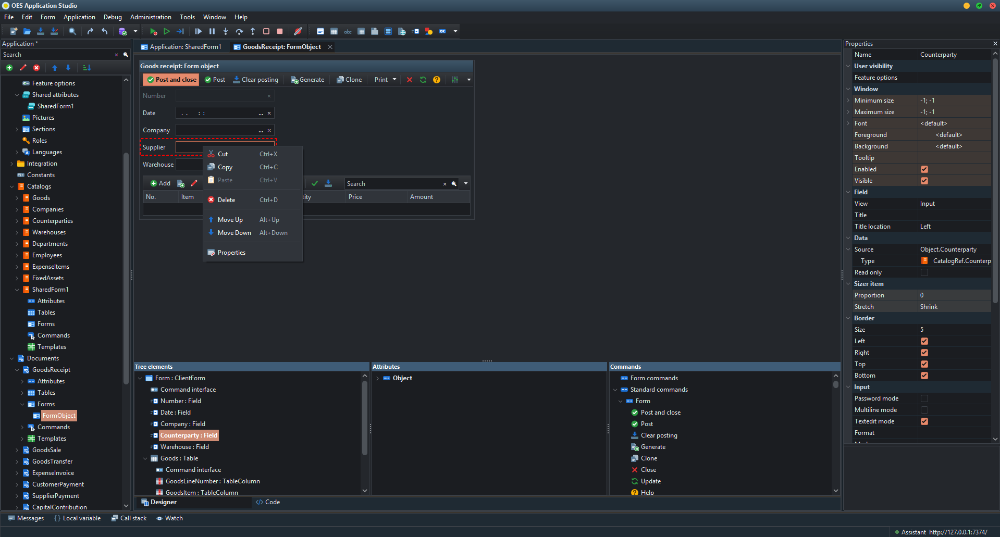
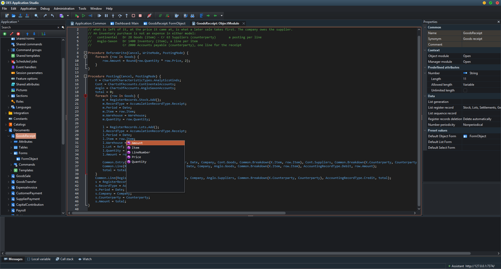
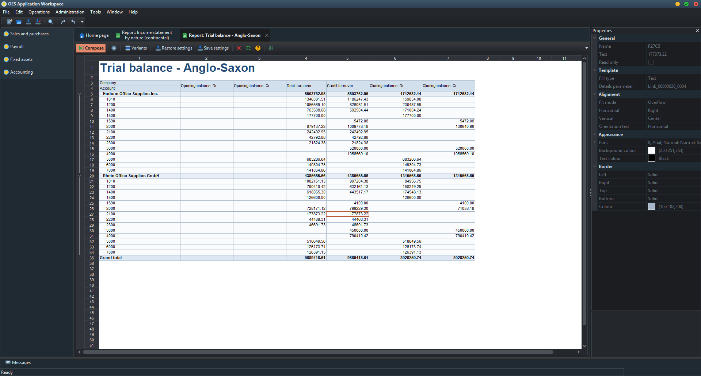
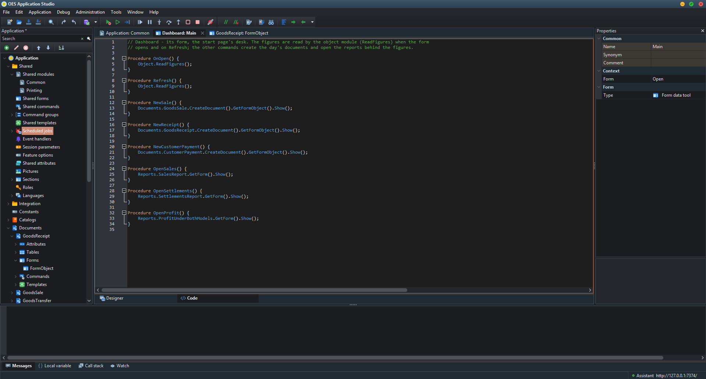
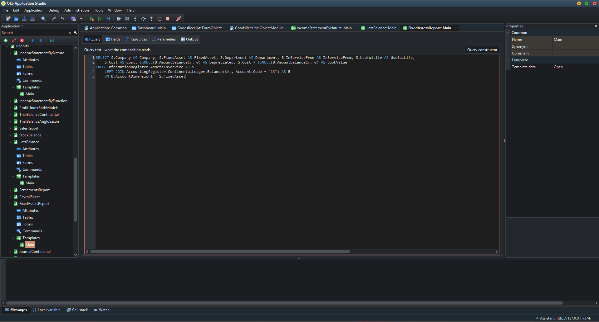
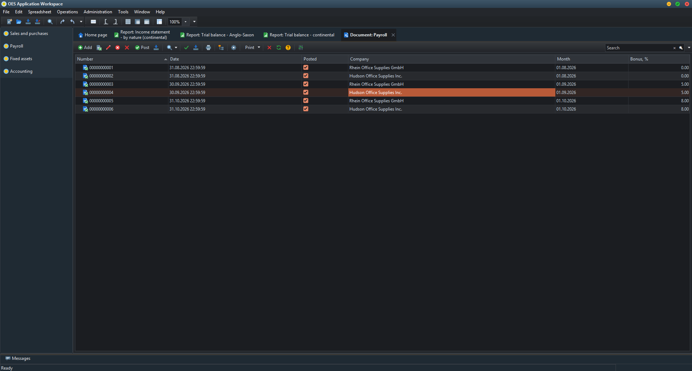
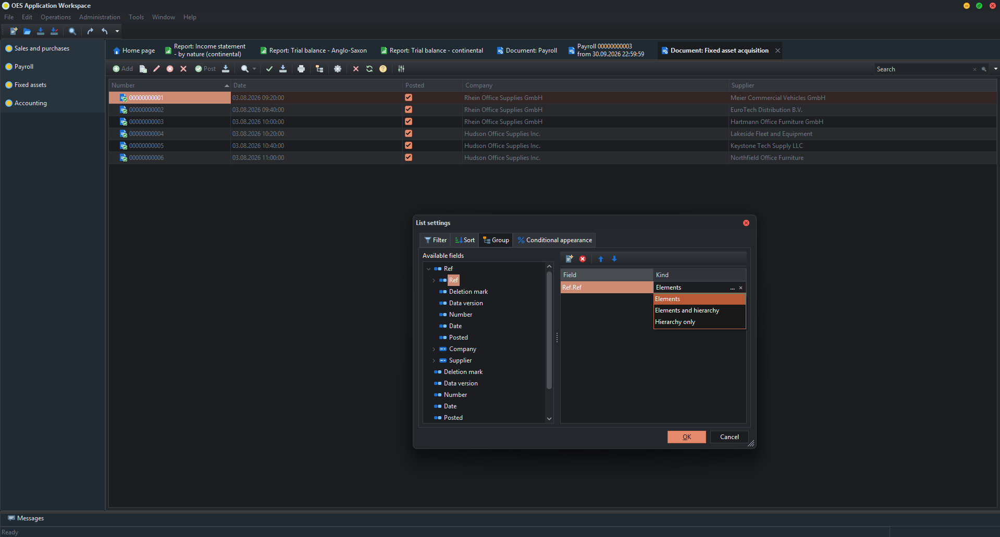
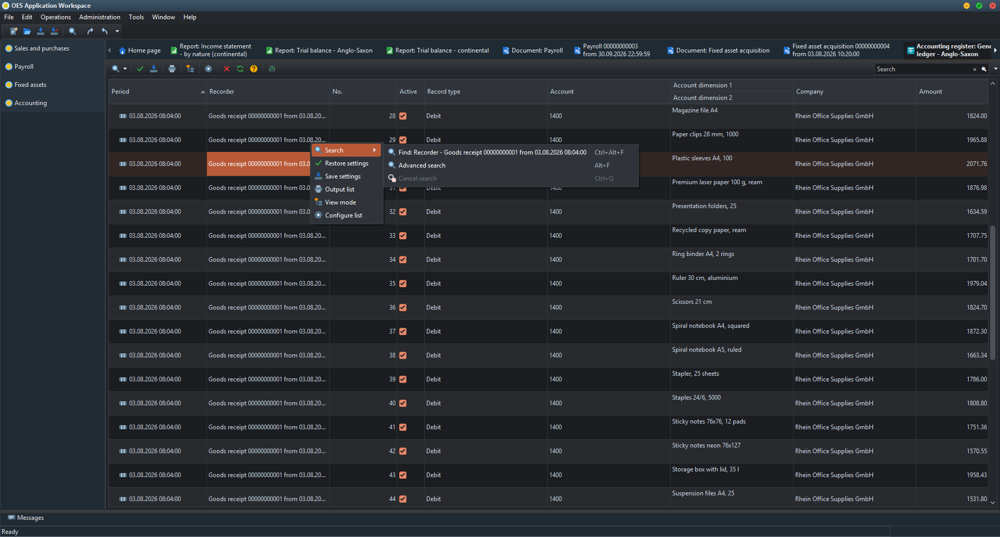
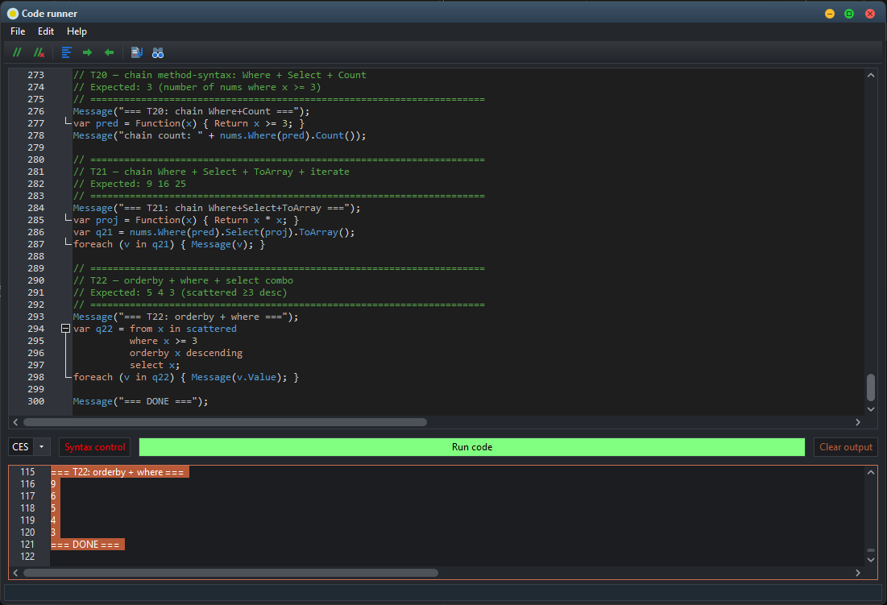

# Open Enterprise Solutions (OES)

[](https://github.com/open-enterprise-solutions/enterprise/actions/workflows/ci.yml)
[](https://github.com/open-enterprise-solutions/enterprise/releases)
[](LICENSE.md)


OES is a source-available platform for building line-of-business applications — stock, accounting,
payroll, sales, whatever a business keeps books on — written in C++20. You describe the business
in **metadata** (catalogs, documents, registers, charts of accounts and of calculation types), write
its rules in a built-in scripting language, and read its data with a **query language and a report
composer**. The platform turns the description into database tables, forms and reports, and keeps
the database in step with the description as it changes.

It ships with everything that loop needs: a studio to build the application in, a compiler and bytecode
interpreter, a remote debugger, a multi-database layer, a job manager, an application server, a cluster that
gives each base a server process of its own, a workspace to work in it and a web server — and a built-in
**MCP server**, so an
AI assistant can read, build and check an application alongside the developer, through the same
doors the developer uses.



**Status: [2.0.0-preview.1](docs/release-notes/v2.0.0-preview.1.md)** — the first release after the alpha, on the
road to beta: the database format may still change, and nothing migrates from 1.x.

**Contents:** [Try it](#try-it) · [What you build with it](#what-you-build-with-it) ·
[A first look at the code](#a-first-look-at-the-code) · [Key features](#key-features) ·
[Screenshots](#screenshots) · [How it is built](#how-it-is-built) · [Supported platforms](#supported-platforms) ·
[Quick Start](#quick-start) · [Build Instructions](#build-instructions) · [Tests and CI](#tests-and-ci) ·
[Documentation](#documentation) · [Project Structure](#project-structure) · [Technology Stack](#technology-stack) ·
[Security](#security) · [Contributing](#contributing) · [License](#license)

## Try it

1. Download the [latest release](https://github.com/open-enterprise-solutions/enterprise/releases/latest):
   Windows x64 (`.zip`), Linux x64 (`.tar.gz`) or macOS arm64 (`.dmg`, unsigned — the
   [installation page](https://github.com/open-enterprise-solutions/enterprise/wiki/Installation) says how to open it).
2. Unpack it and run `launcher`: **Add** a base, choose **File (local database)**, then press **Studio (GUI)**
   (**Designer** in 2.0.0-preview.1).
3. Follow [First steps](https://github.com/open-enterprise-solutions/enterprise/wiki/First-steps): a small stock
   application, built in about fifteen minutes.

Building from source is under [Quick Start](#quick-start).

**New here?** The [wiki](https://github.com/open-enterprise-solutions/enterprise/wiki) is the
user's guide: installing a build, a first application step by step, the studio, the metadata
tree, forms, the language, queries and reports, and the pitfalls.

---

## What you build with it

| Kind | Metadata objects |
|---|---|
| Reference data | Catalog (flat or hierarchical, with predefined items) · Enumeration · Constant · Chart of characteristic types |
| Operations | Document — written, posted into registers, reposted, marked for deletion |
| Registers | **Information** (periodic, with slices) · **Accumulation** (balances and turnovers, trigger-maintained totals) · **Accounting** (chart of accounts, double entry, correspondence, analytics addressed by kind) · **Calculation** (payroll: displacement, base, recalculation) |
| Charts | Chart of accounts · Chart of calculation types (displacing, base and leading types) |
| Processing and reports | Data tool · Report with its own composers · external data tools and reports |
| Application-wide | Shared modules · shared forms, templates and commands · shared attributes · session parameters · feature options · roles · sections (the navigation panel) · languages · pictures · scheduled jobs |



---

## A first look at the code

A document writes its movements into a register when it is posted — the module of a goods receipt, in CES:

```c
procedure Posting(Cancel, PostingMode) {
    foreach (row in Goods) {
        var rec = RegisterRecords.Stock.Add();
        rec.RecordType = AccumulationRecordType.Receipt;
        rec.Period     = Date;
        rec.Product    = row.Product;
        rec.Quantity   = row.Quantity;
    }
}
```

Any module reads the balance back through the query language; the query runs on the database as SQL:

```c
var q = new Query(
    "SELECT B.Product, B.QuantityBalance
     FROM AccumulationRegister.Stock.Balance(&At) AS B");
q.SetParameter("At", CurrentDate());
var table = q.Execute().Unload();   // a value table
```

The tables behind `Goods` and `Stock`, the form a person fills in and the list of documents come from the
metadata — no SQL and no window code are written. [First steps](https://github.com/open-enterprise-solutions/enterprise/wiki/First-steps)
builds this application from an empty base.

---

## Key features

- **Query language** — `SELECT` over the business objects and over the registers' virtual tables
  (`Balance`, `Turnovers`, `BalanceAndTurnovers`, `SliceLast` / `SliceFirst`, `DrCrTurnovers`,
  `RecordsWithAccountDimensions`, `ActualActionPeriod`, `ScheduleData`, `Recalculation`); nested queries, temporary
  tables and query packages, `TOTALS BY … HIERARCHY`, `CAST`, `VALUE`, parameters that keep their
  type. A query runs as SQL on the server wherever the engine can prove it may, and in memory
  otherwise — with the same answer.
- **Report composer** — groupings, totals, cross tables, drill-down from a cell to the records
  behind it, parameters, and the user's own saved settings and variants. Output
  to a spreadsheet document that prints, and exports to **Excel (`.xlsx`, read and write)** and
  **Word (`.docx`, write)**.
- **Scripting language** — two dialects over one compiler (**CES**, C-flavoured, the default; **VES**,
  keyword-fenced), procedures and functions, lambdas with closure capture, `try … except`,
  multi-line strings for query texts, **LINQ** (`from … where … join … group by … orderby … select`)
  compiled into the bytecode, 106 built-in functions and 8 procedures. Bytecode of 82 opcodes, kept
  in an ahead-of-time cache so a module compiles once per application version and engine.
- **Studio** — metadata tree, form designer (drag a field onto a form and a bound control
  appears), code editor with IntelliSense, a query constructor that edits the query inside the
  literal the caret is in, a spreadsheet template editor, application compare, and a git panel.
  Every property carries its own help text.
- **Debugger** — remote, over a WebSocket (ports 7700–7709): breakpoints with conditions, stepping, watches,
  evaluation in the stopped frame; the studio attaches to a workspace on a file base, to a
  workspace's session on its server, or to the web runtime.
- **Access control** — rights per object and operation, folded across a user's roles. A role either
  *permits* (adds rights) or *restricts* (subtracts them, whatever the others grant), so a data
  separator is declared once instead of copied into every role. **Row-level security** is code in the
  role (`OnAccessRead` / `OnAccessWrite`) that narrows what a query may read or write — fail-closed.
- **Schema management** — the application is applied to the database by a diff; a rehearsal shows
  the exact DDL before anything moves; on Firebird a two-phase apply compensates its first commit if
  the second fails, so a refused apply leaves the database where it was.
- **Jobs** — scheduled and background jobs in sessions of their own, with a cross-process claim so a
  job runs once across a cluster; the platform's own housekeeping (totals folding and verification,
  Firebird sweep and backup) runs on the same manager.
- **AI access over MCP** — an assistant's port in the studio and in the workspace, the tools in
  the engine (one MCP server per client, on the file base's or the application server's side), about 140
  tools across the platform: read and edit metadata and modules; apply the application with a rehearsal; run code on the
  application; ask the data questions and compose reports; drive the debugger; read and write the
  registration journal. Protected by a token, listening on loopback by default; every call is
  journalled.
- **Application server** — `appserver` serves one base of the server folder (Firebird and PostgreSQL
  bases side by side in one `server.conf`) for the cluster that starts it: the base's connections,
  sessions, locks, jobs and journal. Several servers may share a base; a file base opened by a client
  and a server may not use one at the same time. Passwords in its configuration are sealed
  (AES-256-GCM).
- **Application cluster** — `appcluster` runs the same server folder as a server process per base and
  holds the clients' port in front of them: a base whose process falls takes only its own clients with
  it and is started again; the other bases do not notice. A console program or a service of the system
  (`appcluster --install` on Windows, a systemd unit on Linux). `appcluster-tray` shows each base's
  server and starts, stops and restarts it — and starts the cluster itself when none runs.
- **Workspace** — `appworkspace` runs no code of the application: the server holds the session,
  its forms and documents, the client draws what it is answered and sends what the person did. One
  [client protocol](docs/public/client-protocol.md) — binary OES-RPC packets over WebSocket, or JSON-RPC
  over HTTP, to an application server; a file base is the same protocol in the client's own process. The
  studio, `appstudio`, works on the same protocol. See [thin-client.md](docs/public/thin-client.md).
- **Databases** — Firebird (embedded, shipped with the distribution) and PostgreSQL for production;
  ODBC; SQLite for tests and logging.
- **Integration** — an application answers HTTP requests of its own ([HTTP services](docs/public/http-services.md))
  and makes them ([HTTP and HTTPS client](docs/public/http-client.md)); [JSON](docs/public/json.md) and
  [XML](docs/public/xml.md) are read and written by a script; COM objects on Windows; an application kept as a
  [directory of text files](docs/public/application-files.md) for version control.
- **Desktop look** — the controls are drawn by the platform itself (the Luna theme), in a light and a dark look
  taken from one [style](docs/public/style.md); its pictures are SVG, drawn at any scale.
- **Localisation** — the whole interface in English, Russian and Ukrainian; every caption of an
  application can be written per language.
- **Web client** — `webserver` serves the application to a browser: it carries it to a file base or to
  an application server's base over the client protocol, with TLS. The page draws what the thin client
  draws — lists, forms, tables, reports and their settings, questions, print — in the person's language,
  on a desktop and on a phone. The studio stays a desktop program.



### Measured

On a 40 000-employee payroll base (Release, x86): a month's payroll reposted in about
**20 s**, the payroll sheet report built in about **4 s**.

---

## Screenshots

<table>
<tr>
<td><br>A form's module in the code editor</td>
<td><br>The query a report's composer reads, over an accounting register's balance</td>
</tr>
<tr>
<td><br>A list of documents in the application</td>
<td><br>A list's settings: filter, sort, groups, conditional appearance</td>
</tr>
<tr>
<td><br>An accounting register's records, searched from the context menu</td>
<td><br>The code runner: LINQ over a collection</td>
</tr>
</table>

---

## How it is built

```
  appstudio (studio)     appworkspace (workspace)            browser
            └─────── frmclient ───────┘                         │ HTTP(S)
              draws what it is answered                     webserver
                         │                                      │
                         └────────── client protocol ───────────┘
                                          │
                    ┌─────────────────────┴─────────────────────┐
                    ▼                                           ▼
          a file base: fileserver,                  appcluster ─► appserver,
          in the process that opens it              a process per base
                    └─────────────────────┬─────────────────────┘
                                          ▼
                frmserver — the forms, the client host, the assistant's tools
                                          ▼
          backend — metadata, compiler and interpreter, queries, composer, sessions, jobs
                                          ▼
                          Firebird · PostgreSQL · ODBC · SQLite
```

- **The client runs no application code.** The server holds the session, its forms and documents; a client draws
  what it is answered and sends back what the person did. The studio, the workspace and the browser reach a
  base through the same [client protocol](docs/public/client-protocol.md) — binary packets over WebSocket, or
  JSON-RPC over HTTP — and an assistant's messages travel inside it.
- **Each base has processes of its own.** A file base lives in the program that opens it; a server base in the
  `appserver` processes the cluster starts for it, so a fault in one base's process does not reach the other bases.
- **`backend` has no UI and `core` has no wx.** `core` — strings, numbers, dates, the node format, the network, TLS,
  pictures — sits under the engine and under the clients alike; the engine and the server-side forms link no GUI
  library, so a server runs headless on every OS.

The full description, directory by directory: [ARCHITECTURE.md](docs/ARCHITECTURE.md).

---

## Supported platforms

| OS | Architecture | Toolchain | Release package | CI |
|---|---|---|---|---|
| Windows 10 / 11 | x64 (x86 builds from source) | MSVC, Visual Studio 2022 (v143) | `.zip` | build + tests |
| Linux — Ubuntu 22.04, Debian 12 or newer | x64 | GCC | `.tar.gz` | build + tests, sanitizers |
| macOS 14 or newer | arm64 (Apple Silicon) | Apple Clang | `.dmg` | build + tests |

A package holds everything its programs need — the Firebird engine for file bases, the PostgreSQL client and
the interface translations. On Linux the desktop programs need GTK 3 (`libgtk-3-0`).

---

## Quick Start

### Windows

1. Install [Visual Studio 2022](https://visualstudio.microsoft.com/) with the **Desktop development with C++** workload
   (the projects use its toolset, v143). CMake is not needed for the MSBuild build.
2. Clone the repository and initialise the submodules:
   ```cmd
   git clone https://github.com/open-enterprise-solutions/enterprise.git
   cd enterprise
   git submodule update --init --recursive
   ```
3. Open `enterprise.sln` in Visual Studio.
4. Select configuration `Debug|Win32` or `Release|x64`.
5. Build the solution (`Ctrl+Shift+B`). Binaries are placed in `bin\<Platform>\<Configuration>\`
   (`Win32` or `Win64`).
6. Run `appstudio.exe` to build an application, `appworkspace.exe` to work in it — or
   `launcher.exe` to pick a base first (it starts the same two programs). `appcluster.exe` serves the bases of a server folder with no
   window, an `appserver.exe` process per base (`appcluster-tray.exe` shows and steers it); both
   clients work in a base it serves, or in a file base.

### macOS

> The CMake build lives at `CMakeLists.txt` (repo root, CMake ≥ 3.20).

```bash
# Install dependencies (wxWidgets is built from its submodule)
brew install cmake ninja

# Clone and initialise submodules
git clone https://github.com/open-enterprise-solutions/enterprise.git
cd enterprise
git submodule update --init --recursive

# Configure and build
cmake --preset macos-release -DOES_USE_FIREBIRD=ON -DOES_USE_POSTGRESQL=ON
cmake --build --preset macos-release
```

### Linux (Ubuntu / Debian)

> The CMake build lives at `CMakeLists.txt` (repo root, CMake ≥ 3.20).

```bash
# Install dependencies (wxWidgets is built from its submodule)
sudo apt update
sudo apt install -y build-essential cmake ninja-build pkg-config \
    libgtk-3-dev libsqlite3-dev uuid-dev libpq-dev

# Clone and initialise submodules
git clone https://github.com/open-enterprise-solutions/enterprise.git
cd enterprise
git submodule update --init --recursive

# Configure and build
cmake --preset linux-release -DOES_USE_FIREBIRD=ON -DOES_USE_POSTGRESQL=ON
cmake --build --preset linux-release
```

---

## Build Instructions

### Windows — MSBuild

```cmd
# From a Developer Command Prompt for VS
msbuild enterprise.sln /p:Configuration=Release /p:Platform=x64 /m
```

Output: `bin\Win64\Release\`

### All Platforms — CMake

The top-level `CMakeLists.txt` (CMake ≥ 3.20) builds every target. DB drivers opt in — `OES_USE_FIREBIRD`, `OES_USE_POSTGRESQL`, `OES_USE_ODBC` (all default OFF); SQLite is always embedded, no flag:

```bash
cmake -B build -DCMAKE_BUILD_TYPE=Release
cmake --build build --parallel
```

wxWidgets is built from its submodule as part of the tree; nothing has to be installed for it.

The unit tests (Google Test) build with the same tree: `-DBUILD_TESTING=ON` — see [Tests and CI](#tests-and-ci).

### wxWidgets Submodule

wxWidgets 3.3.4 lives at `src/3rdparty/wxWidgets` as a git submodule. After cloning:

```bash
git submodule update --init --recursive
```

Every build option, the database drivers and the packaging are in [docs/BUILD.md](docs/BUILD.md).

---

## Tests and CI

The tests are Google Test suites in `tests/`: the compiler, numbers and dates, the query engine on both of its
roads (SQL and in memory) with the same answers required of each, the registers, the report composer, the client
protocol, HTTP and TLS, applying an application to the database, and the accountant's examples checked against
figures computed independently (`tools/oracle/`). They build with the CMake tree:

```bash
cmake -B build -DCMAKE_BUILD_TYPE=Debug -DBUILD_TESTING=ON
cmake --build build
ctest --test-dir build -C Debug --output-on-failure -E oes_pg_dialect_test
```

`oes_pg_dialect_test` needs a live PostgreSQL; CI runs it in a job of its own.

Every push to `develop` and every pull request runs [CI](.github/workflows/ci.yml) — the same suite on each
toolchain, and the jobs a desktop machine does not have:

| Job | What it proves |
|---|---|
| Windows x64 (MSVC), Linux x64 (GCC), macOS 15 arm64 (Apple Clang) | The platform builds and the whole suite passes on three compilers and two architectures; every program links |
| Firebird (Linux) | The Firebird driver against the embedded engine the packages ship |
| PostgreSQL (Linux) | The PostgreSQL driver and dialect against a live server |
| ASan + UBSan (Linux) | No out-of-bounds access, use after free, leak or undefined behaviour in the suite |
| TSan (Linux) | No data race in the code that runs threads: fibers, sessions, the connection pool, locks, jobs |
| Browser client | The web page's own tests |
| Benchmarks (Linux, Release) | The interpreter, the number and the compiler, timed beside a native C++ baseline — recorded, not a gate |

A [nightly build](https://github.com/open-enterprise-solutions/enterprise/releases/tag/nightly) packages `develop`
for all three platforms whenever it changed.

---

## Documentation

| Where | What it holds |
|---|---|
| [The wiki](https://github.com/open-enterprise-solutions/enterprise/wiki) | The user's guide: installing, first steps, the studio, metadata, forms, the language, queries and reports, the application server, pitfalls |
| [docs/public/](docs/public/README.md) | Design documents: how a subsystem works, what it guarantees and where it stops — the query language, registers, access rights, reports, jobs, record locks, numbers and dates, the client protocol, the cluster |
| [docs/ARCHITECTURE.md](docs/ARCHITECTURE.md) | The system, directory by directory |
| [docs/BUILD.md](docs/BUILD.md) | Building on every platform, the drivers, the third-party components and their versions |
| [docs/development.md](docs/development.md) · [docs/writing-code.md](docs/writing-code.md) | How a change is made and reviewed; how the code is written |
| [docs/portability.md](docs/portability.md) | The rules for code that compiles on MSVC, GCC and Clang |
| [docs/ai-context.md](docs/ai-context.md) · [docs/public/ai-quickstart.md](docs/public/ai-quickstart.md) | For an assistant that writes metadata and scripts; connecting one to the studio |
| [docs/release-notes/](docs/release-notes/) | What each release changed, and what has changed since the last one |
| [CLAUDE.md](CLAUDE.md) · [AGENTS.md](AGENTS.md) | The context file for coding assistants: layout, naming, key decisions |

---

## Project Structure

```
enterprise/
├── enterprise.sln            # MSBuild solution (24 projects, Mbed TLS, llhttp, LodePNG, lunasvg, libharu, expat, Scintilla and Lexilla among them)
├── CMakeLists.txt            # the cross-platform build, tests included
├── CMakePresets.json         # the build presets, Debug and Release, per platform
├── Common.props              # Shared MSBuild properties (paths, platforms)
├── ConfigurationDefs.props   # Preprocessor definitions per configuration
├── LICENSE.md                # PolyForm Noncommercial 1.0.0 (source-available)
├── NOTICE.md                 # third-party licenses, the wx fork
├── CONTRIBUTING.md           # what a change looks like, and what sending one grants
├── SECURITY.md               # how to report a vulnerability
├── .github/workflows/        # CI (every push and pull request) and the nightly packages
├── lang/                     # interface translations: the template, and per language (ru, uk) the .po the programs read
├── syntaxHelper/             # the language reference the studio's help shows: every type and function, per language (en, ru, uk)
├── examples/                 # example bases: an English demo of trading, payroll and accounting; a gallery of the controls
├── tools/                    # the demo server's setup, the independent oracle for the accountant's tests
├── tests/                    # Google Test suites (built by CMake)
├── docs/                     # how we work, build, portability, architecture — start with docs/README.md
│   └── private/              # PRIVATE submodule (design docs) — resolves for members of the
│                             # organisation only and is empty for everyone else. The build never
│                             # needs it, so links to docs/private/… will not open for you.
└── src/
    ├── 3rdparty/             # Git submodules: wxWidgets 3.3.4, Mbed TLS, Asio, llhttp, expat, LodePNG, lunasvg, libharu, Lexilla, date, cpp-httplib, nlohmann/json; Scintilla in the tree
    └── engine/
        ├── core/             # What the engine and its clients share: values, strings, dates, nodes, the query text, the journal
        ├── backend/          # Core engine DLL
        │   ├── compiler/     # Lexer, parser, bytecode, interpreter, LINQ
        │   ├── query/        # The query language: lower, render to SQL, run in memory (its text is read in core)
        │   ├── composition/  # The report composer
        │   ├── calculation/  # The calculation register's engine (displacement, base, recalculation)
        │   ├── databaseLayer/# DB abstraction + drivers (Firebird, PostgreSQL, SQLite, ODBC)
        │   ├── metaCollection/  # Metadata: business objects, registers, charts, common objects
        │   ├── job/          # Scheduled and background jobs
        │   ├── session/      # Sessions, their registry and worker pools
        │   ├── lock/         # Record locks, cluster-wide
        │   ├── sheetFormat/  # Spreadsheet import and export (.xlsx, .docx)
        │   ├── debugger/     # Debug server/client (WebSocket)
        │   ├── moduleManager/
        │   ├── propertyManager/
        │   └── system/       # Built-in functions and values
        ├── protocol/         # The client protocol: its contract (protocol.h) and connections
        ├── frmserver/        # The server side of the thin client: sessions, forms, the client host, the MCP server and its tools
        ├── deskgui/          # The desktop's user interface library: the custom-drawn controls and dialogs, the Luna theme
        ├── frmclient/        # The thin client's window, document/view and controls
        ├── fileserver/       # A file base in the thin client's process
        ├── appworkspace/     # The workspace: the application, where a base is worked in
        ├── appstudio/        # The studio: where the application is built
        ├── webserver/        # The bases' transport for browsers and the browser client (www/); links protocol + core
        ├── launcher/         # Launcher (connection chooser)
        ├── appserver/        # The application server
        ├── appcluster/       # The application cluster: a server process per base, the port, restarts; a service
        ├── appcluster-tray/  # The cluster's tray: its servers and their verbs, starting the cluster
        ├── coderunner/       # Script runner (its own code editor, no document behind it)
        └── simple-plugin/    # Example plugin
```

---

## Technology Stack

| Layer | Technology |
|---|---|
| Language | C++20 |
| Text | UTF-16 (`char16_t`) on every OS — one length and one index for a text everywhere, the browser's included; OES-RPC carries it as it lies |
| GUI framework | wxWidgets 3.3.4 as the host; the controls and dialogs drawn by `deskgui` (a fork of the wxUniversal theme engine, the Luna theme) |
| Primary database | Firebird (embedded) |
| Production alternative | PostgreSQL |
| Other databases | ODBC; SQLite (tests + logging) |
| Client protocol | OES-RPC (binary) over WebSocket; JSON-RPC 2.0 over HTTP POST |
| Network | Asio (standalone) + llhttp — the core's HTTP and WebSocket, server and client |
| TLS and ciphers | Mbed TLS |
| Pictures | LodePNG and lunasvg — the core reads, scales and writes PNG and draws SVG; the server has no wx image |
| PDF | libharu — a sheet written as the pages printing lays out, in the server's fonts (Liberation shipped) |
| XML | expat — under the core's reader and writer, the application's files and the spreadsheet formats |
| Code editor | Scintilla and Lexilla |
| AI access | Model Context Protocol (Streamable HTTP) |
| Build (Windows) | MSBuild / Visual Studio 2022 (toolset v143) |
| Build (cross-platform) | CMake ≥ 3.20 — `CMakeLists.txt` at repo root (Windows / macOS / Linux) |
| Tests | Google Test, run in CI (GitHub Actions) |
| License | PolyForm Noncommercial 1.0.0 — source-available, not open source |

Every third-party component, its version and its license: [NOTICE.md](NOTICE.md) and [docs/BUILD.md](docs/BUILD.md).

---

## Security

Please do not report a vulnerability in a public issue. [SECURITY.md](SECURITY.md) says where to send it, what
to include and what happens next, and lists what the platform does to protect a base — password hashing, TLS,
sealed server passwords, the assistant's token.

---

## Contributing

Contributions are welcome — see [CONTRIBUTING.md](CONTRIBUTING.md) for what a change should
look like and, more importantly, for what sending one means.

The short version: branch from `develop` and pull-request into it; match the code around you;
say **why** in the commit message, because the diff already says what. And because this
project is licensed commercially as well as noncommercially, opening a pull request includes a
grant that lets us sublicense your contribution — you keep your copyright, we get the right to
sell what contains it. That paragraph is the one worth reading in full before you send
anything.

Bug reports and feature requests are welcome as GitHub Issues.

---

## License

OES is **source-available, not open source**, under the
[PolyForm Noncommercial License 1.0.0](LICENSE.md). Copyright is held by Maksym Korniienko,
acting as Open Enterprise Solutions until it is registered as a company ([NOTICE.md](NOTICE.md)).

**Free, and meant to be used:** clone it, build it, break it, change it, run it on your own
machine, write applications for it, teach a course from it, write a thesis about it, publish
what you learned. No notification, no permission, no explanation owed to anyone.

**Also free: evaluation, for a business too.** A company or an implementer may install it and
run it to decide whether to build on it — trial applications, test data, its own people.
Live work is not evaluation.

**Needs a license from us:** earning from it. Running it in a business, providing a service
with it, shipping it inside something you are paid for — and, said outright because it is what
these sources are most likely to be taken for, forking it to ship a rival platform or lifting a
piece of it (the query engine, the composition and reporting engine, the metadata layer) into a
product of your own.

**A commercial license is for a build we release** — we answer for it, and it carries the
license check. The platform as you build it yourself may be used for noncommercial and
evaluation purposes: to study it, or to decide whether to use it, for example.

**Under your own brand** — an implementer that takes the platform to its customers under its
own name, builds it itself and licenses it to them on its own terms — the platform is licensed
separately, case by case. It stays ours all the same: we develop it and release its patches,
and the implementer decides whether and when to take them. Its own features on top — what it
sells besides the brand — are its own, because it wrote them. We own the land; what you cook
on it is yours.

What the terms above do not cover is in [NOTICE.md](NOTICE.md): third-party components keep
their own licenses, and the wxWidgets-derived widget sources remain under the **wxWindows
Library Licence**.
